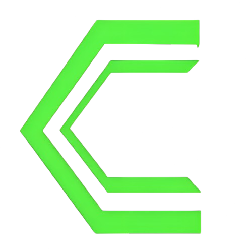

<div align="center">

<!-- Terminal-style Banner -->


<!-- Terminal Typing Animation -->


<br/>

<!-- Links styled as terminal flags -->
[](https://instagram.com/12hrformat)
[](mailto:12hrformat@proton.me)

<br/>
</div>

## User Stats

<div align="center">


<br/>


</div>

---

## whoami
```
cat aboutme.txt

hey there! i'm dragon — a student currently in school,

i'm interested in cybersecurity, programming, linux, and building things that actually work.

currently learning, experimenting, breaking stuff, and making things.

still learning.
```

**What I'm doing:**
-  Trying Bug Bounties
-  Making tools in python
-  Learning Hacking
-  Playing games all the time
-  Learning coding

---

## Things i know

<div align="center">

**`[ security ]`**


##### basic hacking tools and scripts and things

**`[ languages ]`**


-3776AB?style=for-the-badge&logo=python&logoColor=white)


**`[ environment ]`**


</div>

---

<div align="center">

  # Say hi to Copper and Deadlight linux

</div>
  
<div align="center">

**`[ our distros ]`**


</div>

<div alig="center">

### Copper Linux

</div>

<div align="center">
  
</div>

Copper is a daily-driving Linux distro built from source — not a rebrand of
Debian or Arch. We build the kernel, the libc (musl), and the userland
ourselves, and write the parts that make it *Copper* ourselves too: the shell
(`copper-sh`), the init system (`copper-init`), and the first-boot setup
wizard. Arch and Debian are good, but we wanted to do it *our* way — their
source was used for reference, nothing more.

The build pipeline produces a bootable ISO (~600 MB) that boots in a VM, with
XFCE as the desktop target. Wired networking, a hotfix system
(`copper charge` / `copper rollback`), and a real rollback path are in place
— WiFi and the full desktop stack are still being worked out.

[Copper-linux-website](https://12hrformat.github.io/copperlinux-site/)
[12hrformat/copperlinux](https://github.com/12hrformat/copperlinux)

### Deadlight Linux

Deadlight is the security-focused twin of Copper — same base, different
purpose. Where Copper is for daily use, Deadlight is aimed at cybersecurity
work: penetration testing and security research, with the tooling preinstalled
so it works out of the box instead of needing a setup pass afterwards.

**Copper Linux and Deadlight Linux are both made by me and my team.**

---

## `$ cat todo.txt`

**`// learning`**
- [x] Finish Python basics
- [ ] Complete OWASP Top 10 deep dive
- [x] Learn SQL injection hands-on (SQLi labs)
- [ ] Study XSS attack & defense patterns
- [x] Understand CSRF and SSRF vulnerabilities

**`// practice`**
- [x] Set up a home pentesting lab
- [x] Try first CTF challenge
- [x] Root first box on HackTheBox / TryHackMe
- [x] Write a bug report / disclosure write-up

**`// build`**
- [x] Write a Python recon script
- [x] Build a simple port scanner
- [x] Attend a hackathon

---

<div align="center">


</div>
